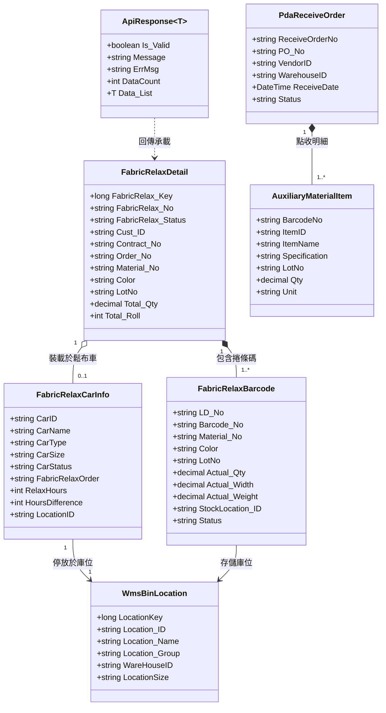
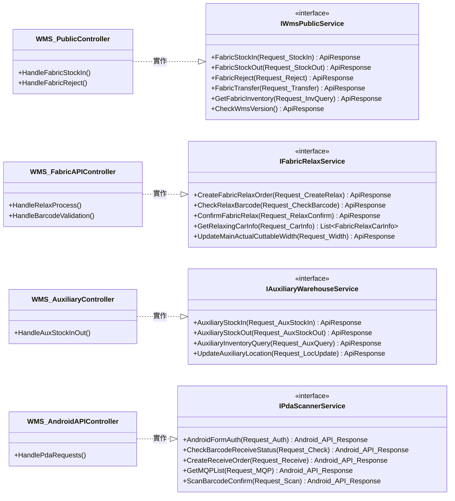
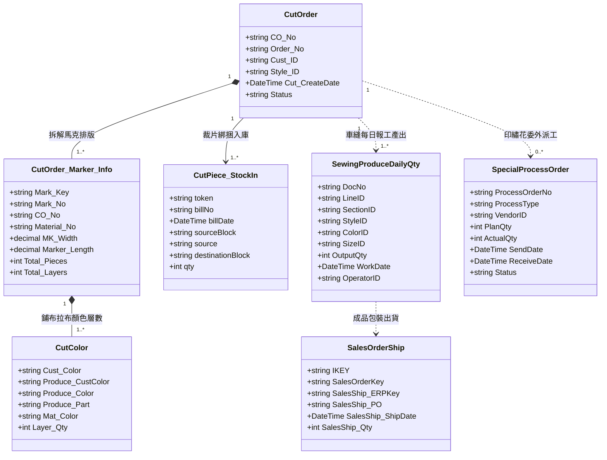
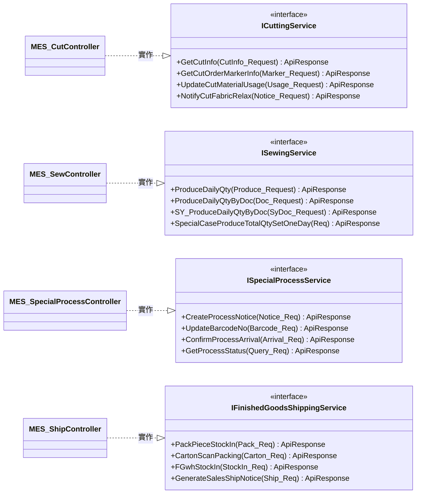
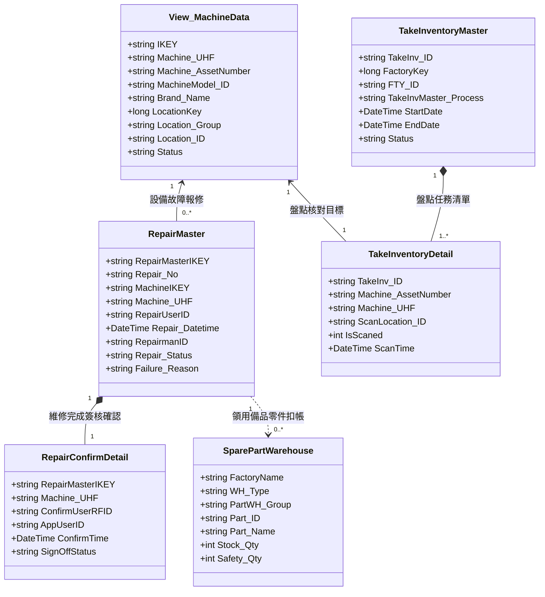
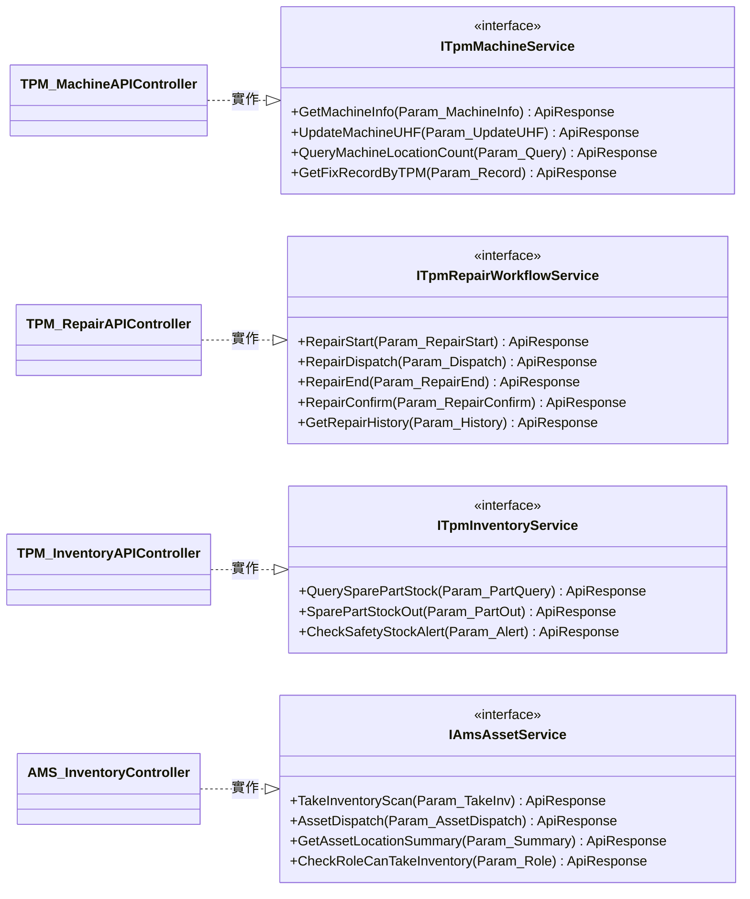
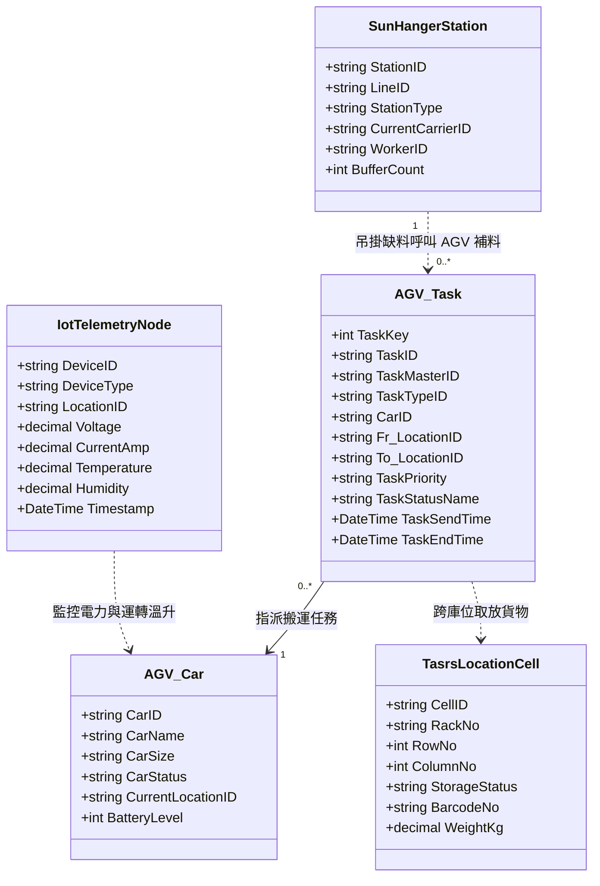
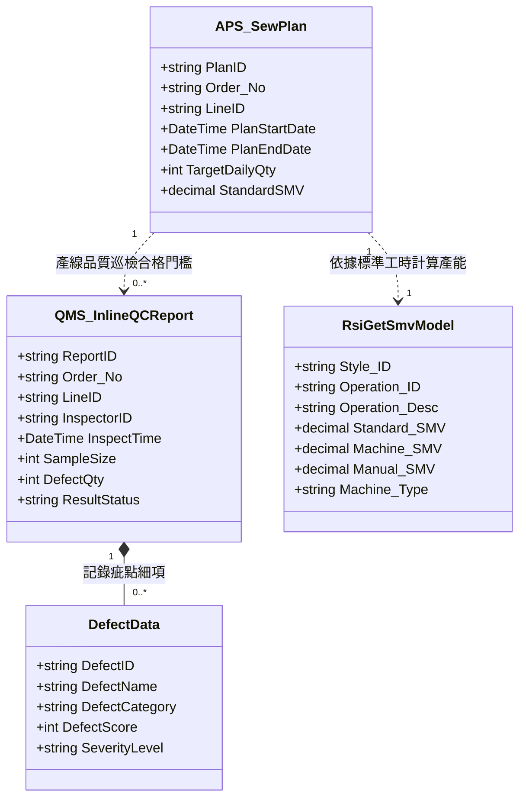

# 信源全球 2027 蜂巢計畫｜技術規格與架構評估專案報告
## Duke 11/12 交付之集團三大核心系統 (RD_SAMPLE、D365、CQS) 與 API 全量清冊深度剖析與落地處方

* **專案計畫**：信源全球 2027 蜂巢計畫 (Project Hive 2027)
* **計畫主持人**：周文津 副總
* **執行負責人 / 外部資訊顧問**：Howard Liao Ph.D.
* **記錄整理 / 研發資訊主管**：Duke Chen
* **發布日期**：2026 年 11 月 12 日（2026 年 11 月 13 日完整審核增訂）
* **機密等級**：內部機密（RESTRICTED）
* **文檔編號**：RSI-HIVE-20261112-DUKE-API-SPEC-V2

---

## 一、執行摘要與標竿定位 (Executive Summary)

研發資訊主管 Duke 於 2026 年 11 月 12 日正式提交並確認了信源集團內部核心三大系統之架構與串接盤點資料（對應 RSI 1109 會議決議第一項）：
1. **`RD_SAMPLE` 樣品管理系統（雛型 v0.1）**：包含系統卡、draw.io 雙頁圖、21 條跨系統串接拓撲矩陣（I01～I21）、Windows 排程器 13 項重要定時任務清查及 7 大架構資安風險。
2. **`D365 F&O (ERP)` 核心系統（雛型 v0.1）**：涵蓋地端 LBD 部署拓撲、21 條跨系統串接拓撲矩陣（D01～D21）、海外 8 廠 WMS 資料庫 IP 矩陣、14 個 Service Group / 31 個 Service / 80 個 Operation 之 X++ Custom Service，以及 RSIMDW1 上的 C# 外掛中介層（50 支 API）。
3. **`CQS` 報價成本系統（雛型 v0.1）**：涵蓋 Vue 3 + .NET 8 ASP.NET Core 架構、13 條跨系統串接拓撲矩陣（C01～C13）、177 支 CQS API、5 大批次作業（含致命之 C08 直接寫入生產庫 AXDB 議題）及 IIS ARR 反向代理拓撲。
4. **`API List` 全量清冊**：整合 D365 C# 外掛 API（Report API、Local API）、共用資料模型 `RqtBaseForm`（14 個共用欄位）、X++ Custom Service 規範（Azure AD Bearer Token 驗證）與共用回傳格式 `RSI_RT`。

**顧問評估結論**：
Duke 所主導之三大系統盤點展現了卓越的工程紀律與深度，全量 55 條串接拓撲（I01～I21, D01～D21, C01～C13）與 13 項排程任務已全面確認，正式定調為信源集團各廠區系統盤點的**「金牌示範標竿（Gold Standard）」**。本報告依據全量規格進行深度評鑑，提出 4 大工程落地處方，並列出向 Duke 溫暖致謝與 5 大技術對齊議題。

---

## 二、模組一：RD_SAMPLE 樣品管理系統（雛型 v0.1）深度解構

### 1. 系統基本資料卡 (SOFT-00)
* **系統代號**：RD_SAMPLE (SOFT-00)
* **系統名稱**：樣品管理系統（打樣／研發流程）
* **技術棧**：前端 ASP.NET WebForms (.NET 4.8) + Knockout.js / jqxGrid；後端自寫 DataAccess (ADO.NET 直連 SQL)；Tech Pack 解析器採用 Python。
* **部署主機**：
  * 正式機：`RDSMP2` (192.168.0.22)
  * 測試機：`RDSMP1` (192.168.0.23)
* **版控與 CI/CD**：GitLab `rd/rd_sample`；Runner 位於 RDSMP1，dev 分支部署測試、master 分支部署正式（msbuild + robocopy）。

### 2. 21 條跨系統串接拓撲矩陣 (I01～I21 全覽)
| 編號 | 對象系統 | 方向 | 串接方式／協定 | 端點（正式） | 觸發 | 用途說明 | 依據 |
|---|---|---|---|---|---|---|---|
| I01 | 使用者瀏覽器 | ← | HTTPS 443 | `rdsample.rsiapparel.com` (192.168.0.22) | 即時 | 系統操作與打樣維護 | Web.config |
| I02 | 本地 SQL Server | → | TDS 1433 (ADO.NET) | RDSMP2 (192.168.0.22) / RD_SAMPLE | 即時 | 樣品業務主庫讀寫 | 連線字串 |
| I03 | PDFTAG 資料庫 | → | 同 SQL 執行個體跨庫查詢 | RDSMP2 / PDFTAG | 即時 | Tech Pack 結構化資料比對 | 程式碼查詢 |
| I04 | CQS 資料庫 | → | 同 SQL 執行個體跨庫查詢 | RDSMP2 / CQS | 即時 | 報價用量與成本查詢 | 程式碼查詢 |
| I05 | 越南廠區 RDV 庫 | → | TDS 1433 (專線直連) | 192.168.185.123 / RDV_SAMPLE | 排程 30分 | 越南打樣進度同步 (Sync_RSV.bat) | 排程腳本 |
| I06 | 柬埔寨廠區 RDG 庫 | → | TDS 1433 (專線直連) | 192.168.193.65 / RDG_SAMPLE | 排程 30分 | 柬埔寨打樣進度同步 (Sync_RSG.bat) | 排程腳本 |
| I07 | D365 AXDB 主庫 | → | TDS 1433 直讀 (sa 帳號) | RSIAXDB1 (192.168.0.131) / AXDB | 即時+排程 | 23 處直讀物料、顏色、客戶主檔 | GetDatabase("AX") |
| I08 | D365 C# Local.WebApi | → | HTTP 80 | RSIMDW1 (192.168.0.95) / Auth | 即時 | 代為取得 D365 Bearer Token | AX_token 設定 |
| I09 | D365 X++ Custom Service | → | HTTPS 443 (Bearer) | AOS / api/services/JCOM_* | 即時 | 拋轉日記帳、採購與物料異動 | ERP_API_Model.cs |
| I10 | D365 ERP (反向呼叫) | ← | SOAP ASMX | RDSMP2 / SAM/WEBSERVICE/RdsmpService.asmx | ERP 觸發 | RequestBOM, 同步主檔資料 | ASMX 原始碼 |
| I11 | UOF BPM 簽核系統 | → | SOAP over HTTPS | bpm.rsiapparel.com (192.168.8.226) | 即時 | 樣品核准流程簽核 | BPMService.cs |
| I12 | UOF BPM 資料庫 | → | TDS 1433 直讀 | 192.168.8.226 / UOF | 即時 | 簽核狀態與歷程查詢 | 連線字串 |
| I13 | 郵件伺服器 | → | SMTP 25 | 192.168.0.35 (RSIMBX1) | 排程/即時 | 發送打樣通知信 (SendNotification.bat) | MailHelper.cs |
| I14 | AWS AI 規格推論服務 | → | HTTP 8000 | 98.84.29.205:8000 / inference | 即時 | Tech Pack 智慧版型推論 | 呼叫端程式碼 |
| I15 | AWS 翻譯服務 | → | HTTP 80 | 98.93.175.234:80 / translate | 即時 | 規格說明中越英多語系翻譯 | 呼叫端程式碼 |
| I16 | 檔案共用伺服器 | → | SMB 445 | \192.168.0.22\Storage | 即時 | 樣品圖檔、PDF Tech Pack 存放 | 路徑設定 |
| I17 | 舊版圖檔伺服器 | → | HTTP 8081 | 192.168.0.23:8081 (依賴測試機!) | 即時 | 舊款樣品照片檢視 (FindImage) | 程式碼硬編碼 |
| I18 | AD 網域控制站 | → | LDAP 389 | 192.168.0.10 (RSIAD1) | 即時 | 人員帳號密碼 Windows 驗證 | Membership |
| I19 | GitLab CI Runner | ← | SMB 445 (robocopy) | GitLab (192.168.10.134) -> RDSMP2 | push CI | 程式碼編譯部署覆蓋 | gitlab-ci.yml |
| I20 | 舊版 MSC DB (已停用) | → | TDS 1433 | 192.168.3.120 / MSC2003 | — | 停用殘留連線 (部分報表殘留) | Web.config |
| I21 | 舊版 MES DB (停用查核) | → | TDS 1433 | 192.168.0.125 / MES_OLD | — | 停用殘留連線 | Web.config |

### 3. Windows 工作排程器 13 項重要任務明細
1. `SendNotification.bat`：每 5 分鐘執行，發送打樣逾期與簽核通知。
2. `Sync_RSV.bat`：每 30 分鐘執行，雙向同步越南廠打樣進度（程式內建 23:00–06:00 避峰）。
3. `Sync_RSG.bat`：每 30 分鐘執行，雙向同步柬埔寨廠打樣進度（程式內建 23:00–06:00 避峰）。
4. `DailySewnReport.bat`：週一至六 06:01 執行，匯總前日車縫樣品產能日報。
5. `SyncHRM.bat`：每日 10:45 執行，自人資系統同步員工組織與離在職名單。
6. `ScheduleSummary.bat`：週一至六 21:01 執行，計算當日打樣進度甘特排程統計。
7. `updateColorFromERP.bat`：每日 23:01 執行，自 D365 AXDB 同步標準顏色代碼。
8. `updateColorMappingFromERP.bat`：每日 23:15 執行，同步買主顏色映射主檔。
9. `InsertMaterialERP.bat`：每日 23:19 執行，將打樣新料號回拋 ERP 審核暫存檔。
10. `updateMaterialERP.bat`：每日 23:31 執行，自 D365 更新物料最新採購狀態與單價。
11. `SP_FITSOP_NT.bat`：每週日 20:00 執行，重算全廠試穿樣（Fit Sample）標準工時。
12. `DeleteRpaFile.bat`：每週日 02:07 執行，清理伺服器暫存 RPA 圖檔與 PDF 暫存。
13. `UpdateCustEstSMV.bat`：每半年（1/1、7/1）10:58 執行，更新客戶預估標準工時矩陣。

### 4. 7 大架構與資安盤點風險 (R1～R7)
* **R1 明碼帳密**：Web.config 與 bat 腳本內硬編碼資料庫帳密。
* **R2 全數 sa 權限連線**：跨庫查詢使用 sa 帳號，缺乏最小權限原則。
* **R3 正式機依賴測試機**：I17 舊圖檔介面正式機指向 `192.168.0.23:8081`（測試機），測試機若當機影響正式環境。
* **R4 AWS 公網未加密連線**：I14、I15 呼叫公有雲 AI 服務走未加密 HTTP 明文，存在中間人竊聽風險。
* **R5 跨國專線 TDS 1433 直連**：I05、I06 跨國直接以 TDS 協定同步資料，海纜延遲或斷線容易引發連線逾時。
* **R6 SQL 字串拼接**：歷史老舊程式碼存在 SQL 字串拼接寫法，具 SQL 隱碼風險。
* **R7 跨系統直讀 DB 與 MSC 殘留**：直讀 AXDB 造成 ERP 結構更動風險，且已停用 MSC 伺服器連線未徹底移除。

---

## 三、模組二：D365 F&O (ERP) 核心系統（雛型 v0.1）深度解構

### 1. 系統基本資料卡 (D365)
* **系統代號**：D365
* **系統名稱**：Microsoft Dynamics 365 Finance & Operations (ERP)
* **部署型態**：**地端部署（LBD, Local Business Data）**：Service Fabric 叢集＋SQL Server＋ADFS，全部位於台北總部機房。
* **系統負責單位**：ERP 組
* **預設公司別**：`DataAreaId = GRSI`
* **客製範圍**：
  * X++ model：`JCOM_WebServices`（顧問廠商 JCOM）、`RSI_WebServices`（自研）。
  * Custom Service：共 **14 個 Service Group、31 個 Service、80 個 Operation**。
* **外掛中介層**：C# (.NET Framework 4.8 / ASP.NET Web API 2)，部署於 `RSIMDW1 (192.168.0.95)`。
  * `Local.WebApi`（24 支 API）
  * `D365.Report.Service`（26 支報表 API）
  * `Local.Batch`（背景排程批次）
  * `ERP_WMS_inventory`（ERP 與 WMS 庫存對帳服務）
* **環境端點**：
  * 正式：`rsiax.rsiapparel.com`
  * 測試：`labax.rsiapparel.com` (LAB)
  * 開發：RSIAXDEV1～9 開發虛擬機
* **身分驗證**：走地端 ADFS（`d365ffoadfs.rsict.com.tw`）OAuth2；外掛提供 `/Auth` 代取 Bearer Token。
* **版控與 CI**：C# 外掛由 GitLab `d365/d365` 管理，Runner 在 RDSMP1，robocopy 至 `\\192.168.0.95\d$\D365`；X++ 由 RSIAXDBT1（192.168.0.130）建置經 LCS 套件發布。

### 2. 21 條跨系統串接拓撲矩陣 (D01～D21 全覽)
| 編號 | 對象系統 | 方向 | 串接方式／協定 | 端點（正式） | 觸發 | 用途說明 | 依據 |
|---|---|---|---|---|---|---|---|
| D01 | 使用者瀏覽器 | ← | HTTPS 443 (ADFS) | `rsiax.rsiapparel.com` (AOS x3 DNS輪詢) | 即時 | 總部與各廠日常 ERP 業務操作 | DNS |
| D02 | ADFS 認證伺服器 | → | OAuth2 / OpenID (HTTPS 443) | `d365ffoadfs.rsict.com.tw` (192.168.0.109) | 即時 | 使用者登入與服務權杖發行 | 外掛設定檔 |
| D03 | AXDB (D365 主庫) | → | TDS 1433 (鏡像高可用) | RSIAXDB1 .131 / RSIAXDB2 .132 | 即時 | D365 核心財務交易與業務資料 | 外掛設定檔 |
| D04 | SSRS / MR 報表 | → | 內部 Service Fabric 通訊 | RSIAXSRS1 .129; RSIAXMR1/MR2 .127~.128 | 即時 | 財務報表、發票與出貨單據產生 | ERP 組確認 |
| D05 | RD_SAMPLE 系統 | ← | HTTPS 443 (/api/services/...) | JCOM_ImportJournalServices 等 5 類服務 | 即時 | 物料入庫、日記帳、MS/PO 查詢 | rd_sample RouteFile |
| D06 | RD_SAMPLE 系統 | ← | HTTP 80 | Local.WebApi `GET /Auth` (RSIMDW1) | 即時 | 代取 D365 授權 Bearer Token | rd_sample AX_token |
| D07 | RD_SAMPLE 系統 | ← | TDS 1433 直讀 (帳號 wms) | AXDB (192.168.0.131) | 即時+排程 | 約 23 處直讀物料、顏色、客戶主檔 | rd_sample 原始碼 |
| D08 | 生產周邊 (MES/WMS/APS/QMS) | ← | HTTPS 443 (/api/services/...) | JCOM_MESToERPServices, JCOM_Production 等 | 即時/批次 | 生產工單、報工、領料、出貨拋轉 | Notion X++ 清單 |
| D09 | 外掛 Local.Batch | → | HTTPS 443 (/api/services/...) | AOS (RSI_Services/RSI_DailyBatch/*) | 排程 | 每日同步產地、目的地、款式、客戶、SMV | RouteFile.json |
| D10 | 外掛程式 (三支) | → | TDS 1433 直讀 (帳號 sa) | AXDB (192.168.0.131) | 即時+排程 | 報表與查詢直接讀取 D365 資料表 (約 22 處) | ConnectionStrings |
| D11 | ODS 操作資料庫 | → | TDS 1433 | 192.168.0.7 (RSIESB1) / ODS | 即時+排程 | 報表資料來源、物料與銷售控制 | Report API 設定 |
| D12 | MSC2003 (舊 ERP) | → | TDS 1433 (已停用) | 192.168.0.120 / MSC2003 | — | 歷史 MSC 版報表 (物料需求、採購) | Report API 設定 |
| D13 | 廠區 WMS 資料庫 (8 廠) | → | TDS 1433 (跨國專線, whuser) | 各海外廠 WMS 資料庫 (見下表) | 即時+排程 | 庫存報表、ERP 與 WMS 庫存差異比對 | ERP_WMS_inventory |
| D14 | RD_SAMPLE 資料庫 | → | TDS 1433 | RDSMP2 (192.168.0.22) / RD_SAMPLE | 即時 | Local.WebApi「RD 樣品」API (8 支) | Local.WebApi 設定 |
| D15 | RSIERP 資料庫 | → | TDS 1433 (EF) | 192.168.0.11 / RSIERP (殘留設定未呼叫) | — | 歷史系統殘留連線設定 | Local.Batch 設定 |
| D16 | 外掛自用資料庫 | → | TDS 1433 | RSIMDW1 / D365_Prod, D365_Uat | 即時 | Buyfile、參數設定、檔案匯出紀錄 | 外掛設定檔 |
| D17 | 報表檔案下載服務 | ← | HTTP 80 | `http://192.168.0.95/Storage/...` | 即時 | 報表 API 回傳之靜態檔案下載 URL | Report API 程式 |
| D18 | 集團郵件伺服器 | → | SMTP 587 | `mail.rsiapparel.com` | 排程 | 庫存差異通知、批次錯誤告警 (mis_erp@) | ERP_WMS_inventory |
| D19 | 報表 API 呼叫端 | ← | HTTP 8085 (Prod) / 8082 (UAT) | `D365.Report.Service` (RSIMDW1) | 即時 | EDD 報表匯出 (呼叫端為 D365 畫面) | Notion C# API 清單 |
| D20 | GitLab CI 部署 | ← | HTTP 拉碼 + SMB 445 robocopy | GitLab (192.168.10.134) -> RSIMDW1 | push CI | C# 外掛自動化建置與伺服器部署 | .gitlab-ci.yml |
| D21 | D365 ERP (主動反拋) | → | SOAP (ASMX) | RD_SAMPLE / SAM/WEBSERVICE/RdsmpService.asmx | ERP 觸發 | RequestBOM, 同步品項、顏色、客戶 | rd_sample I10 |

### 3. 海外廠區 8 廠 WMS 資料庫對照矩陣 (D13)
| 廠區代碼 | 廠區名稱／地點 | 資料庫主機 IP | 預設資料庫名稱 | 連線協定與帳號 |
|---|---|---|---|---|
| **RSA** | 總部廠區 A | `192.168.50.6` | `WareHousing` | TDS 1433 / whuser |
| **RSB** | 越南廠區 B | `192.168.33.11` | `WareHousing` | TDS 1433 / whuser |
| **TOP** | 越南 TOP 廠 | `192.168.33.124` | `WareHousing` | TDS 1433 / whuser |
| **RSG** | 柬埔寨 RSG 廠 | `192.168.168.6` | `WareHousing` | TDS 1433 / whuser |
| **RSK** | 柬埔寨 RSK 廠 | `192.168.60.9` | `WareHousing` | TDS 1433 / whuser |
| **RSV** | 越南 RSV 廠 | `192.168.97.8` | `WareHousing` | TDS 1433 / whuser |
| **SY** | 緬甸 SY 廠 | `192.168.180.34` | `WareHousing` | TDS 1433 / whuser |
| **RVT** | 越南 RVT 廠 | `192.168.113.34` | `WareHousing` | TDS 1433 / whuser |

### 4. X++ Custom Service 架構分類清單 (14 類 Service Group / 80 Operations)
| Service Group 群組名稱 | 包含 Service 數 | Operation 數 | 核心業務用途與主要呼叫端系統 |
|---|---|---|---|
| **JCOM_MatTransServices** | 4 (MS, MT, MAB, ADJ) | 16 | 物料各類異動（領料、調撥、調整）；主要由 RD_SAMPLE 與 WMS 呼叫 |
| **JCOM_SalesServices** | 3 | 8 | 款式主檔維護、外箱標籤裝箱、客戶發票處理 |
| **JCOM_ProductionServices** | 3 | 6 | 生產工單拋轉、現場報工、領料過帳；主要由 MES 呼叫 |
| **JCOM_SalesOrderToMES** | 3 | 4 | 銷售訂單 (SO) 拋轉 MES 製造現場排產 |
| **JCOM_MESToERPServices** | 1 | 1 | MES 製造現場工單完成與用料即時回拋 ERP |
| **JCOM_NonMPOPickingJournalService**| 1 | 3 | 非 MPO 生產領料日記帳維護 |
| **JCOM_ImportJournalServices** | 1 | 2 | 外部日記帳批次匯入；主要由 RD_SAMPLE 呼叫 |
| **JCOM_BomImportFromRDServices** | 1 | 2 | 自研發樣品系統匯入標準 BOM |
| **JCOM_LBServices** | 2 | 2 | 外部供應商裝箱單核對、採購單 (PO) 狀態即時查詢 |
| **JCOM_LDServices** | 1 | 1 | LD 實驗室打色與配方數據同步 |
| **JCOM_APSServices** | 1 | 1 | 高級排程系統物料毛淨需求運算介面 |
| **JCOM_PrepareMaterialService** | 1 | 1 | 生產前置備料指示與齊料檢驗 |
| **RSI_Services** | 8 (DailyBatch, Agent 等) | 30 | 自研外掛排程、Buyfile 買主檔、QMS 品管、異常工單管理 |
| **RSI_SynchronizeDataToRDSampleServices** | 1 | 3 | 核心品項 (Items)、顏色 (Colors)、客戶 (Customers) 同步至樣品系統 |

---

## 四、模組三：CQS 報價成本系統（雛型 v0.1）深度解構

### 1. 系統基本資料卡 (CQS)
* **系統代號**：CQS
* **系統名稱**：報價成本系統 (Cost Sheet)
* **業務定位**：物料主檔維護、產生／核准內外部報價單、報價歷程追蹤、報價用量回寫 ERP、實際用量成本差異分析。
* **技術棧**：
  * 前端：Vue 3 + Vite + TypeScript (現代化 SPA 單頁應用)
  * 後端：CQSService (.NET 8 / ASP.NET Core Web API, EF Core)
  * 批次：CQS_Batch (.NET 8 Console 批次執行檔)
* **API 規模現況**：共計 **177 支 API**：
  * CostSheet 報價核心：63 支
  * Material 物料維護：40 支
  * ERP 介接：12 支
  * 系統管理權限：34 支
  * 其他輔助功能：28 支
* **身分驗證**：IIS Windows 整合驗證（AD 帳號），登入後自動映射 CQS 系統使用者。
* **資料庫環境**：CQS 主庫；另跨庫查詢 PDFTAG、RD_SAMPLE (同 SQL 實例)，並直連 D365 AXDB。
* **主機環境**：正式 RDSMP2 (`192.168.0.22`) Web 8012 / API 8011；測試 RDSMP1 (`192.168.0.23`) Web 8012 / API 8011。
* **部署與版控風險**：GitLab `cqs/cqs`，**目前完全沒有 CI/CD 管道**，採人工手動複製覆蓋伺服器部署。

### 2. 13 條跨系統串接拓撲矩陣 (C01～C13 全覽)
| 編號 | 對象系統 | 方向 | 串接方式／協定 | 端點（正式） | 觸發 | 用途說明 | 依據 |
|---|---|---|---|---|---|---|---|
| C01 | 使用者瀏覽器 | ← | HTTP 8012 (Windows 驗證) | `http://192.168.0.22:8012` | 即時 | 報價人員維護報價單與成本試算 | BPM 設定 CQSUrl |
| C02 | CQSService API | 內部 | HTTP 8011 `/api/*` | `http://192.168.0.22:8011` | 即時 | 前端 SPA 呼叫後端 REST API | .env.production |
| C03 | CQS 專屬資料庫 | → | TDS 1433 (EF Core) | RDSMP2 / CQS | 即時+排程 | 報價核心業務資料持久化 | CQSDatabase |
| C04 | PDFTAG 資料庫 | → | TDS 1433 | RDSMP2 / PDFTAG | 即時 | 由 Tech Pack 自動產生報價料號對照 | PDFDatabase |
| C05 | RD_SAMPLE 資料庫 | → | 同 SQL 實例跨庫查詢 | RDSMP2 / RD_SAMPLE.dbo.* | 即時+排程 01:00 | 讀取物料、顏色、客戶與用碼量 | commonFunction.cs |
| C06 | D365 AXDB 主庫 | → | TDS 1433 直讀 (sa 帳號) | RSIAXDB1 (192.168.0.131) | 即時 | 查詢 ERP 料號、BOM 與實際發料 | ERPDatabase |
| C07 | D365 AXDB (Linked Server) | → | SQL Server Linked Server | `[RSIAXDB1].[AXDB]` | 即時 | 跨庫取系統標準 SMV 工時值 | costSheetFunction.cs |
| **C08**| **D365 AXDB (直接寫入!)** | → | **TDS 1433 直接 UPDATE** | `UPDATE BOM SET JCOM_BOMQTYQUOTE` | **操作即時觸發** | **報價用量直接回寫生產主 BOM** | **CQSUpdateERPBOMQtyQuote** |
| C09 | D365 外掛 Local.WebApi | → | HTTP 80 經 IIS ARR 轉發 | RSIMDW1 (192.168.0.95) /rd/MarkAndTrimInfo | 即時 | 取樣品馬克圖與副料用量資訊 | ARR 反向代理 |
| C10 | BPM 簽核系統 | → | SOAP over HTTPS | bpm.rsiapparel.com (192.168.8.226) | 即時 | 報價單送簽（依毛利率動態核決） | BPMService.cs |
| C11 | RD_SAMPLE 系統 | ← | HTTP 經 ARR 轉 8011 | 192.168.0.22:8012 /api/SysUser/CreateSysUser | 即時 | RD 建立帳號時同步建 CQS 帳號 | FND004ViewModel |
| C12 | 集團郵件伺服器 | → | SMTP 25 (帳號 Notify) | 192.168.0.35 (RSIMBX1) | 批次執行時 | 發送批次執行結果與異常通知 | MailSender.cs |
| C13 | RD_SAMPLE 網站 | → | 網頁超連結跳轉 | `https://rdsample.rsiapparel.com/SAM/STYLE/` | 即時 | 從報價單直接開樣品款式明細頁 | RDSampleWeb 設定 |

### 3. CQS_Batch 5 大批次作業詳細對照
* **執行主機**：RDSMP2 正式機 (`192.168.0.22`) `D:\CQSService\Batch\CQS_Batch.exe`。
1. **`RDSAMPLEInsertMaterial`** (RD_SAMPLE → CQS)：排程每日 01:00 執行，亦可由畫面手動點擊；將樣品新物料同步寫入 CQS 物料庫。
2. **`CQSUpdateERPBOMQtyQuote`** (CQS → **AXDB 直接寫入**)：**重大架構卡點**！由使用者在畫面審核時以 `Process.Start` 即時啟動，直接下 SQL UPDATE 覆寫 D365 生產庫中的 BOM 用量。
3. **`CQSCreateCABatch`** (AXDB → CQS)：使用者點擊成本分析時以 `Process.Start` 啟動，依 ERP 實際發料計算各色組實際用量與成本偏差。
4. **`TPInsertMaterial`** (PDFTAG → CQS)：**已停用**；早期將 Tech Pack 料號寫入物料主檔之批次。
5. **`ERPUpdateMaterial`** (AXDB → CQS)：**已停用**；早期更新 ERP 物料主檔之舊程式。

---

## 五、模組四：集團三大 API 清冊與標準化契約 (API List)

### 1. D365 C# 外掛 API 雙核心專案 (RSIMDW1 192.168.0.95)
* **`D365.Report.Service` (Report API)**：
  * UAT：`http://192.168.0.95:8082/swagger`（規格檔：`/swagger/docs/v1`）
  * Prod：`http://192.168.0.95:8085`（無 Swagger 介面）
  * 共 26 支報表匯出 API，回傳產生的靜態檔案下載 URL 字串。
* **`Local.WebApi` (Local API)**：
  * UAT：`http://192.168.0.95:8081/swagger`（規格檔：`/swagger/docs/v1`）
  * Prod：`http://192.168.0.95:80`（無 Swagger 介面）
  * 共 24 支業務 API（含 `/Auth` 代取 Bearer Token、RD 樣品 8 支 API、庫存同步等）。
* **共用 Request Model (`RqtBaseForm`)**：
  * 繼承欄位：`SalesId`, `StyleNo`, `ContractNo`, `ContractGroup`, `PurchId`, `ItemId`, `VendId`, `CustId`, `_key`, `BuyKeys`, `ContractNos`, `BatchNos`, `DataAreaId`, `UserName`。

### 2. D365 X++ Custom Service (80 Operations 呼叫契約)
* **呼叫格式**：一律 `POST https://<host>/api/services/<serviceGroup>/<service>/<operation>`，`Content-Type: application/json`。
* **身分驗證**：必須帶 Azure AD / ADFS Bearer Token（`Authorization: Bearer <token>`），呼叫端 App 必須於 Microsoft Entra 登記。
* **共用 Response Model (`RSI_RT`)**：
  ```json
  {
    "IsValid": true,
    "Msg": "Operation Succeeded",
    "TotalCount": 150,
    "DataList": [ { ... } ]
  }
  ```

---


---

## 六、模組五：Factory API 工廠端 488 支全量端點規格與資安體檢（iDrive 最新交付）

> **資料來源**：Duke 於 Synology iDrive 交付之 `FactoryAPI_20261113.zip`（由 `tools/OpenApiGen` 自動解析 `Factory_API` 原始碼生成之 OpenAPI 3.0 規範與互動式文件）。

### 一、基本資訊與架構現況
* **文件版本**：`2026.11.13`
* **端點總數**：**488 支 Operations**（475 支 POST + 13 支 GET）
* **模組分群**：共 **50 個業務模組 Tags**
* **在線互動檢視器**：`https://howardliao.github.io/RSI/FactoryAPI/index.html`

### 二、核心模組分類與 API 規模
1. **工廠倉儲物流 (WMS / INV / ASRS)**：
   * `WMS_Public` (49 支)：出入庫、調撥、盤點核心
   * `WMS_FabricAPI` (27 支)：布料檢驗、捲號條碼掃描
   * `WMS_Auxiliary` (21 支)：副料收發與退料管理
   * `WMS_AndroidAPI` (16 支)：手持 PDA 掃碼作業
   * `WMS_Subcon` (5 支)、`WMS_WF` (3 支)
   * `SUN_TASRS` (9 支)：自動立體倉儲 (ASRS) 存取排程
2. **生產製造執行 (MES / QMS / 吊掛)**：
   * `MES_Cut` (11 支)：裁剪車間、拉布與馬克圖
   * `MES_SpecialProcess` (9 支)：印花、繡花、特殊製程
   * `MES_Sew` (6 支)：車縫產線進度與報工
   * `MES_Pack` (5 支)、`MES_Ship` (5 支)、`MES_FGwh` (4 支)
   * `QMS_MES` (11 支)：巡檢、抽檢與疵點統計
   * `SUN_Hanger` (5 支)：智慧車縫吊掛生產線排站
   * `GIL_CutAsRs` (8 支)：裁片自動立庫排程
   * `AGV_Public` (13 支)：廠內無人搬運車調度
3. **設備與資產維護 (TPM / AMS)**：
   * `TPM_DispatchAPI` (45 支)：機台派工單開立與調派
   * `TPM_InventoryAPI` (27 支)：備品零組件庫存與警示
   * `TPM_RepairAPI` (22 支)：現場報修與工時紀錄
   * `TPM_AttachmentAPI` (20 支)：保養手冊與現場相片
   * `AMS_Dispatch` (26 支)、`AMS_Inventory` (19 支)：固定資產調撥與 RFID 盤點
4. **進度排程與物聯網 (APS / IOT / INA)**：
   * `APS_Sew` (4 支)、`APS_Order` (3 支)、`APS_Event` (2 支)
   * `INA_DataInfo` (12 支)、`IOT_DataInfo` (7 支)：溫濕度、電表與產線感測數據

### 三、關鍵架構缺陷與資安風險診斷
1. **完全無驗證防護（重大資安漏洞）**：
   * 官方說明直接註明：`目前沒有驗證機制（無 Authorization header）`。
   * 廠區內部網路任何設備（包括被入侵的 PC 或惡意終端）皆可隨意呼叫任何 488 支 API，直接修改庫存、指派 AGV 甚至竄改維修工單。
2. **錯誤處理隱蔽（HTTP 200 遮蔽）**：
   * 即使業務邏輯失敗（如庫存不足、查無單號），伺服器依然回傳 `HTTP 200 OK`，只在 Response Body 中附帶 `Is_Valid = "N"`。外部 Gateway 難以直接以 HTTP Status Code 進行熔斷或重試策略。
3. **缺乏宣告式驗證約束**：
   * 程式碼中完全沒有 `[Required]` 等資料驗證標籤，欄位檢核均寫在 Controller 內，各模組行為不一致。

## 七、Factory API 領域類別圖 (Class Diagrams) 與介面服務圖 (Interface Diagrams)

本章針對 Duke 於 2026.11.13 交付之 Factory API 488 支端點與 50 個業務 Tags，依據 DDD 領域驅動設計原則拆解為 5 大核心領域之 UML 2.0 實體類別圖與服務介面契約圖。

線上互動式 UML 檢視器：[https://howardliao.github.io/RSI/FactoryAPI/factory_uml_diagrams.html](https://howardliao.github.io/RSI/FactoryAPI/factory_uml_diagrams.html)

### 7.1 WMS 倉儲與物料物流領域 (Warehouse Domain)

#### 7.1.1 實體類別圖 (Class Diagram)


#### 7.1.2 服務介面圖 (Interface Diagram)


---

### 7.2 MES 製造執行與成衣全流程領域 (Manufacturing Domain)

#### 7.2.1 實體類別圖 (Class Diagram)


#### 7.2.2 服務介面圖 (Interface Diagram)


---

### 7.3 TPM & AMS 設備運維與資產管理領域 (Maintenance & Asset Domain)

#### 7.3.1 實體類別圖 (Class Diagram)


#### 7.3.2 服務介面圖 (Interface Diagram)


---

### 7.4 智慧物流硬體與 IoT/AGV/立庫領域 (Hardware & Automation Domain)

#### 7.4.1 實體類別圖 (Class Diagram)


---

### 7.5 QMS 品質管理與 APS 排程整合領域 (Quality & Scheduling Domain)

#### 7.5.1 實體類別圖 (Class Diagram)


---

## 八、Howard Liao Ph.D. 首席顧問四大工程處方（全面升級修正版：深度融合 488 支 Factory API）

本四大工程處方在深度消化 Duke 於 2026.11.13 交付之 Factory API 488 支端點（50 個業務 Tags、583 個 Data Schemas）後，進行了精準的架構深化與升級。從原先基於 55 條宏觀拓撲的架構防禦，正式躍升為**涵蓋海外 8 廠地端實體控制器與硬體協同的全鏈路落地工程處方**。

### 處方一：C08 報價與海外 8 廠 MES/WMS 高頻交易之「雙向防腐層（ACL）與 ERP 交易解耦」
* **問題根因**：
  1. CQS 報價系統直接下 SQL UPDATE 覆寫 D365 AXDB 主庫的 `BOM.JCOM_BOMQTYQUOTE`，跳過 ERP 商業邏輯驗證、審計軌跡與併發鎖定。
  2. 深入盤點 488 支 Factory API 後發現，海外 8 廠 `ERP_WMS_inventory` 與每日高頻車縫報工 `ProduceDailyQty` 亦存在跨國專線直連 TDS 1433 與直接鎖庫隱患，一旦海纜抖動或跨國長事務掛起，極易引發 AXDB 主庫全域鎖死（Deadlock）。
* **工程落地解方**：
  1. **雙向防腐層 (Anticorruption Layer, ACL)**：立即廢止跨國 Direct SQL 與 Linked Server，全面改由 D365 X++ Custom Service 進行封裝（如 `RSI_BOMQuoteUpdateService`）。
  2. **事件驅動非同步回寫 (Event-Driven Persistence)**：CQS 報價審核與工廠端每日報工改發送非同步業務事件，由 D365 內部 X++ 交易事務（`ttsbegin` / `ttscommit`）進行校驗回寫，確保 ERP 財務與庫存主檔之交易一致性與審計日誌（Audit Log）完整。

### 處方二：全鏈路 543 支 API 零信任收斂與「總部–廠端兩級 API Gateway」落地
* **問題根因**：
  1. 總部端：RD_SAMPLE (21)、D365 (21)、CQS (13) 共 55 條串接拓撲分散於非標準 HTTP 端口，且 C# 外掛 80/8085 端口全無認證。
  2. **工廠端最大資安破口**：Duke 交付之 488 支 Factory API 經查核**「全數無任何身分驗證（無 Authorization Header / 無 API Token）」**，且業務錯誤多以 `HTTP 200 OK` 包覆 `Is_Valid = 'N'`，缺乏標準 HTTP 錯誤碼，極易引發內網未授權偽造派工與監控盲區。
* **工程落地解方**：
  1. **兩級式 API 閘道體系 (Two-Tier API Gateway)**：
     * **總部端 (HQ Gateway)**：部署 Microsoft YARP Gateway，將 D365 / CQS / RD_SAMPLE 對外端點統一收斂至 HTTPS 443，強制掛載 Microsoft Entra ID (Azure AD) OAuth2.0 / JWT 驗證。
     * **廠端邊緣閘道 (Edge Gateway)**：在海外 8 廠 IIS 前端加掛輕量級邊緣閘道（Envoy 或 YARP Edge），對內網手持 PDA、車載 AGV、立庫與產線 PC 實施 HMAC / JWT Token 檢驗。
  2. **錯誤碼與契約標準化轉譯**：由邊緣閘道攔截器將傳統 `Is_Valid = 'N'` 自動映射為標準 RFC 7807 Problem Details 與 HTTP 4xx/5xx 狀態碼，達成 100% 零信任架構且「零改動既有 Controller 原始碼」。

### 處方三：海外 8 廠離線自律 (48-72 小時) 之實體化落地（以 Factory API 為地端核心）
* **問題根因**：海外廠區過去高度依賴總部連線，海纜或專線中斷時常造成打樣、裁片與車縫現場停擺。
* **工程落地解方（獲 488 支 API 實體支撐）**：
  1. **確立 Factory API 為地端獨立運行核心**：分析確認地端 WMS (49 支)、MES (Cut/Sew 50+ 支)、TPM/AMS (120+ 支) 及 AGV/立庫已具備完整本地商業邏輯，**完全具備在地閉環自律運作條件**！
  2. **精準收斂總部依賴**：廠端僅需依賴 2 支核心查詢 API 下載總部主檔——`RSI_GetSMVToMES`（標準工時）與 `RSI_GetRDInfo`（款式版型），其餘 486 支 API 均於地端邊緣伺服器自主處理。
  3. **Transactional Outbox 斷網容錯與自動對齊**：地端所有生產報工與庫存出入庫先持久化至本地端 SQLite / SQL Express 佇列；海纜復原後，透過帶有 `Idempotency-Key` 的重試機制自動增量同步回總部，真正落實「斷網不停產 72 小時、復網不衝突」。

### 處方四：CQS、C# 外掛與 Factory_API 原始碼之「全自動 CI/CD 與 OpenApiGen 契約防禦」
* **問題根因**：CQS 系統無 CI 自動化、C# 外掛採 robocopy 人工覆蓋、工廠端 Factory API 雖具備 `tools/OpenApiGen` 但尚未形成自動化相容性檢測流水線。
* **工程落地解方**：
  1. **全流水線化 (Automated Pipeline)**：將 CQS、C# 外掛與 Factory_API 原始碼納入 GitLab CI / GitHub Actions 流水線，代碼提交即自動執行單元測試、靜態安全掃描（SAST）與容器化建置。
  2. **OpenAPI 契約自動防禦 (Contract Breaking-Change Guard)**：在 CI 流水線中整合 Duke 現有之 `tools/OpenApiGen`，每次發版自動生成最新 `openapi.json`，並比對是否發生破壞性變更（如必填欄位更名、型別變更），若有破壞性變更自動阻斷 Merge Request。
  3. **組態與憑證外部化**：全面拔除原始碼與 Web.config 中的資料庫連線字串與帳密，統一接入 Azure Key Vault 或地端 HashiCorp Vault。

---

## 九、向 Duke 溫暖致謝與 6 大面向技術對齊探討清單（新增 Factory API 邊界防護焦點）

> **致 Duke 的技術致敬簡函**：  
> 「Duke 您好：非常感佩您與研發、ERP 團隊在 11/12 與 11/13 所整理交付的整套系統規格與串接矩陣！從 RD_SAMPLE 的 21 條拓撲、D365 的 21 條拓撲、CQS 的 13 條連線，到今日 Synology iDrive 交付的 Factory API 全量 488 支端點與 OpenAPI 規範，整體資料具備極高的系統深度與工程穿透力，為信源 2027 蜂巢計畫奠定了最堅實的數位基石。為了讓後續跨系統架構對接更加平穩高效，顧問團隊在此列出 6 個關鍵技術焦點，期待與您溫暖對齊交流！」

1. **焦點一【C08 報價回寫 ERP 邊界仲裁】**：
   * 目前 CQS 的 `CQSUpdateERPBOMQtyQuote` 採直接 UPDATE D365 AXDB。評估是否在 2027 蜂巢計畫中，由 ERP 組開放專屬 X++ Custom Service 操作，讓報價用量回寫納入 D365 交易鎖定與審計日誌？
2. **焦點二【C# 外掛 API 驗證機制無縫升級】**：
   * 目前 RSIMDW1 上的 `Report.Service` (:8085) 與 `Local.WebApi` (:80) 無認證。是否可由外掛目前的 `/Auth` 端點延伸，全面加上 ADFS / Entra ID Bearer Token 檢核，防範內網未授權呼叫？
3. **焦點三【海外 8 廠 WMS 跨國 TDS 直連轉型】**：
   * 目前 `ERP_WMS_inventory` 透過專線跨國直連 8 廠 TDS 1433。未來是否規劃在海外廠區部署輕量微服務，將庫存比對改為每日增量 JSON 拋轉，降低專線抖動對總部排程的衝擊？
4. **焦點四【CQS 系統版控與 CI/CD 落地】**：
   * 盤點指出 CQS 前端 (Vue 3) 與後端 (.NET 8) 尚無 CI 自動化部署。顧問團隊可協助於 GitLab 配置建置腳本與 Runner，免除人工覆蓋伺服器檔案的營運風險。
5. **焦點五【正式機對測試機依賴之清理 (I17)】**：
   * 樣品系統 I17 圖檔檢視目前正式機硬編碼指向測試機 `192.168.0.23:8081`。建議安排工單將測試機舊圖檔遷移至正式儲存伺服器，消除此一單點脆弱性。
6. **焦點六【Factory API 488 支端點邊界安全防護與狀態碼標準化交流（今日新增）】**：
   * 今日研讀您交付的 488 支 Factory API，其對 WMS、MES、TPM、AGV 與立庫的業務封裝極具深度與完整度，團隊由衷感佩！在細部規範中注意到目前端點設計採內網信任架構（無 Auth Header），且業務錯誤採 HTTP 200 包覆 `Is_Valid = 'N'`。想與您溫暖請益：在 2027 蜂巢計畫中，團隊是否可在廠端入口規劃輕量級邊界安全中繼層（例如以 Envoy 或 YARP 輕量閘道集中檢驗 Token 並做錯誤碼轉譯），以減輕各業務 Controller 改寫負擔，同時大幅強化海外 8 廠的縱深防禦能力？
